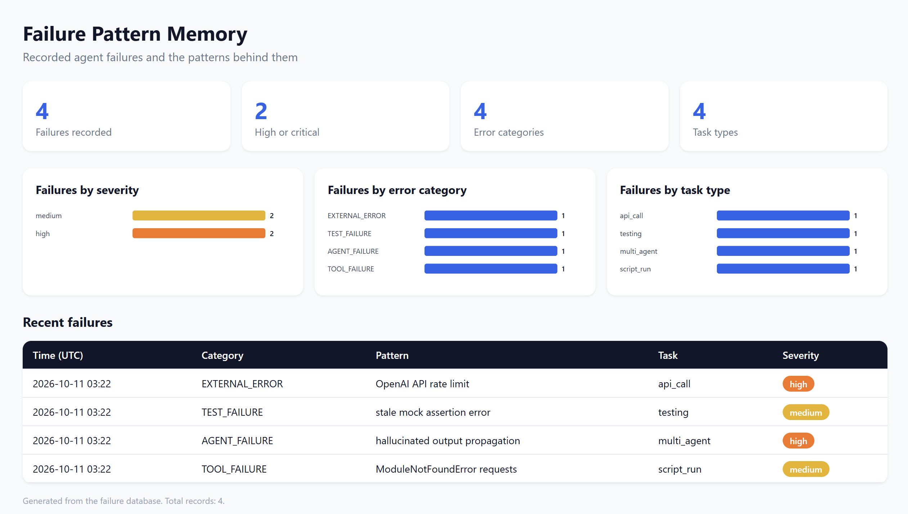

# Failure Pattern Memory

Give AI agents a memory of their own mistakes. When an agent fails, the lesson is recorded.
Before a similar task runs again, the agent gets a warning with how to prevent the failure.

## The Problem

Agents usually handle errors reactively. An agent hits an error, a human or a retry fixes it,
and the fix is forgotten. The next run, or the next agent, makes the same mistake again.

For example, an agent runs a script that imports `requests`, and the package isn't installed.
The run fails, someone runs `pip install requests`, and the agent continues. Next week, on
another machine, the same crash happens with no record of the fix.

## What It Does

1. **Records failures.** A raw error log is classified by an LLM (Groq) into a category,
   description, root cause, prevention step, and severity.
2. **Stores them locally.** Records go into SQLite. Context patterns are embedded and indexed
   with sqlite-vec for similarity search. No separate database server is needed.
3. **Warns before a task.** A new task description is matched against stored failures, and
   similar past failures come back with prevention advice.
4. **Shows results.** A CLI, a REST API, and a generated HTML dashboard.

The memory gives advice. Your agent code decides what to do with it. See "Using it in an agent" below.

## Project Layout

```
fpm/            core package (models, storage, classifier, engine, cli)
api.py          FastAPI server
dashboard.py    builds dashboard.html from the failure database
demo.py         sample run
tests/          offline tests (no API key, no model download)
```

## Quick Start (Windows PowerShell)

```powershell
python -m venv venv
venv\Scripts\activate
pip install -r requirements.txt
pip install -e .
copy .env.example .env          # then put your GROQ_API_KEY in .env
python demo.py
python dashboard.py demo.db
start dashboard.html
```

Linux / macOS: use `python3 -m venv venv`, `source venv/bin/activate`, and `cp .env.example .env`.

## Usage

```powershell
fpm record "ModuleNotFoundError: No module named 'requests'" --task script_run
fpm check "run python script that imports requests"
fpm history
uvicorn api:app --reload        # then open http://127.0.0.1:8000/docs
```

## Using It in an Agent

```python
from fpm.engine import FailurePatternMemory

memory = FailurePatternMemory()

# Before a task: check for known risks
for warning in memory.check_before_task("install packages and run a script that imports requests"):
    print(f"[{warning.severity}] {warning.prevention}")

# When a task fails: store the lesson
try:
    run_agent_step()
except Exception as e:
    memory.record_failure(str(e), task_type="script_run", agent_id="my-agent")
    raise
```

## Tests

Offline tests use a fake classifier and embedder, so they need no API key or model download:

```powershell
pytest -q
```

## Sample Output



## Requirements

- Python 3.10+
- A Python build whose `sqlite3` supports loadable extensions (python.org and conda builds do)
- A Groq API key for recording failures (`demo.py`, `fpm record`, and the API's record endpoint)

## Limitations

- Warnings are advice. Nothing stops an agent automatically unless your code checks and acts on them.
- The `resolution` field is stored as "pending". Recording how a failure was fixed would make
  warnings more useful.
- Classification quality depends on the LLM, so review records before relying on them.
- Similarity uses a general sentence embedding, so the threshold may need tuning on real logs.
